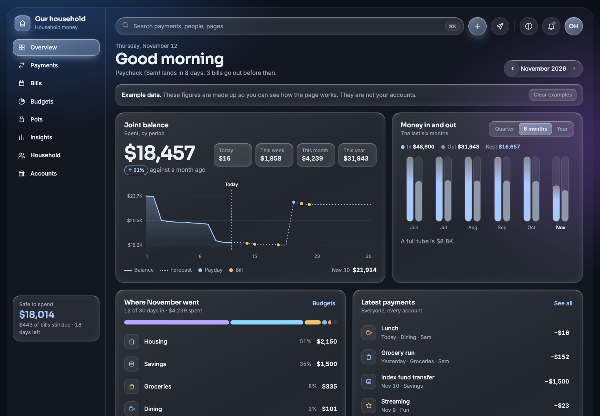

# Personal Finance Dashboard



The screenshot shows the made-up example data that ships with the page, not real accounts.

A household money page you run on your own computer and open from any device on your home
network. One Python file, no dependencies, no accounts, no cloud. Your figures stay in a single
JSON file on your machine.

```bash
git clone https://github.com/ameyarya/personal-finance-dashboard.git
cd personal-finance-dashboard
python3 server.py
```

Open <http://localhost:8770/>. From a phone or another computer on the same Wi-Fi, open
<http://finances.local:8770/>.

It starts with made-up example figures so you can look around. Press **Clear examples** on the
page when you are ready to enter your own.

## What it does

- **Overview.** Joint balance, what is safe to spend after bills, and a forecast to the end of
  the month that marks each payday and bill.
- **Cards.** One card face per card in your statements: tap to flip, spending by month, a monthly limit reminder.
- **Year view.** Every page has a Month / Year switch next to the date arrows.
- **Payments.** Add, edit, search, filter, delete with undo, import a bank statement, export.
- **Bills.** Regular bills and paydays. Tick them off as they happen.
- **Budgets.** A monthly limit per category, with a marker for where spending should be today.
- **Pots.** Savings goals you move money into.
- **Insights.** Spending by day, needs against wants against savings, categories over six months.
- **Household.** Who spent what.
- **Accounts.** Which statements the figures came from, statement import, backup.

Light and dark themes. Works on a phone. Ten currencies.

## Getting your real figures in

There are three ways. You can mix them.

| Way | Effort | How current |
|---|---|---|
| Type payments in | Per payment | As current as you are |
| Import a CSV statement from your bank's website | A minute, whenever you like | As of the export |

**CSV import.** Download a statement as CSV from your bank, then use *Payments → Import CSV*. The
columns are detected from their names (date, description, and either one amount column or separate
money-in and money-out columns). You see a preview before anything is saved. Importing the same
file twice adds nothing. Categories are guessed from the description, and when you correct one you
can tick a box to remember it.

**Statements.** For a whole year at once, `tools/import_statements.py` loads card and cash-account exports in one go (run it with `--help`). It files card payments and moves between your own accounts as Transfer so nothing is counted twice, and keeps refunds as refunds.

## Where your data lives

```
data/data.json      everything you see on the page
```

The `data/` folder is in `.gitignore`. Back up `data.json`, or use *Accounts → Download a backup*.

## Statement PDFs

*Accounts → Statement sync* reads PDF statements and adds any payments the dashboard does not have yet.
Point it at the folder on this Mac that holds your statement PDFs (type the path or press **Choose…**). The server checks on its own
(every hour by default, only while the computer is awake) and there is a **Sync now** button, also in the
top bar.

```bash
python3 -m venv .venv && .venv/bin/pip install -r requirements.txt   # pypdf reads the PDFs
.venv/bin/python server.py
```

PDFs are read on this computer. Wells Fargo cards, Bank of America accounts, Wealthfront cash accounts and
Capital One year-end summaries have their own readers; other card statements go through a general one. Files
that are not understood are listed on the page, never guessed at.

### Data check

The **Data check** page answers "is everything here, and is it right?". Each statement prints an opening and a closing
balance; the check adds the transactions read from it to the opening balance and compares the result with the closing
balance. It also lays each account out month by month and names the months with no statement, balances that do not carry
over from one statement to the next, files that could not be read, and accounts whose newest statement is old. The
Overview shows a notice until everything is complete. It is built during a sync, so use *Sync now* with a full re-read
once after updating. Statements that do not print both balances are marked "not cross-checked".

## HTTPS

Pass a certificate and key and the page is served over https on the same port:

```bash
mkcert -install                      # once, trusts a local certificate authority
mkcert -cert-file data/cert.pem -key-file data/key.pem finances.local localhost 127.0.0.1
python3 server.py --cert data/cert.pem --key data/key.pem
```

Other devices need the mkcert root certificate installed before they trust it. The certificate and key stay
in `data/`, which is not in git.

## Signing in

By default anyone on your home network can open the page. To require a password, open the avatar menu (top
right) and choose **Turn on sign-in**: pick who you are, set a password (8+ characters), and everyone else will
need a name and password too. From the same menu you can give each person their own password, change yours,
sign out, or turn sign-in off again (that asks for your password).

Passwords are stored as salted hashes in `data/users.json`, sessions as hashes in `data/sessions.json`, both
readable only by you and both outside git. Five wrong tries lock that device for a minute. If a password is
forgotten, run this on the computer that serves the page:

```bash
.venv/bin/python server.py --reset-password YourName
```

## Who can reach it

Anyone on your home network can open and change the page. There is no password, so treat it like
a shared notebook on the kitchen table.

- Requests from outside private network addresses are refused.
- Other websites cannot write to it.
- Only the files in `public/` are served.
- To keep it to one computer, run `python3 server.py --bind 127.0.0.1`.

Do not expose the port to the internet.

## Options

```
python3 server.py --port 8770          port to listen on
                  --bind 0.0.0.0       address to listen on (127.0.0.1 for this computer only)
                  --name finances.local  name announced on the network ("" to turn off)
                  --data ./data        folder for data.json
                  --empty              start with no example data
                  --quiet              do not log each request
```

The `.local` name is announced with `dns-sd` on macOS or `avahi-publish` on Linux, if present.
Without either, use the computer's IP address.

On macOS, if other devices cannot connect, the firewall may be blocking Python. Allow incoming
connections for it in *System Settings → Network → Firewall → Options*.

## Start it at login

**macOS.** Edit the two paths in `deploy/launchd.plist.template`, then:

```bash
cp deploy/launchd.plist.template ~/Library/LaunchAgents/local.finance-dashboard.plist
launchctl bootstrap gui/$(id -u) ~/Library/LaunchAgents/local.finance-dashboard.plist
```

**Linux.** Edit the path in `deploy/finance-dashboard.service`, then:

```bash
cp deploy/finance-dashboard.service ~/.config/systemd/user/
systemctl --user enable --now finance-dashboard
```

## Keeping personal information out of git

Every clone should run `sh tools/install-hooks.sh` once. It turns on three git hooks (in `.githooks/`) that
refuse a commit, a commit message or a push containing personal information:

- your own private terms, listed in `.privacy-terms.local` (git ignores that file; `tools/privacy-terms.example`
  shows the format): names, employer, landlord, street, merchants, account digits;
- anything personal in any project: email addresses, phone numbers, card and social security numbers, tokens,
  home-folder paths and home-network addresses;
- statement and credential files: pdf, csv, xlsx, certificates, `users.json`, `data/`, `*.local` files.

The report says where and what kind, never the value. CI runs the generic checks over every commit. Examples
and tests use invented names and numbers only; real figures live in `data/` and in `*.local` files.

## Tests

```bash
python3 -m venv .venv && .venv/bin/pip install -r requirements-dev.txt
.venv/bin/playwright install chromium     # or set PW_CHANNEL=chrome to use installed Chrome
.venv/bin/pytest
```

Over 340 tests: the server, sign-in, statement readers, importer, privacy scanner and the page driven in a browser. The use cases and every flow
they cover are listed in [tests/TEST_CASES.md](tests/TEST_CASES.md). Tests use their own temporary
data folder and never touch `data/`.

Coverage: `sh tools/coverage.sh` runs everything and reports Python (100%) and the page's JavaScript
(about 93% of statements; the rest are guards the UI cannot reach). Needs `npm` once in `tools/js-coverage`.

## Layout

```
server.py            the whole server: storage, CSV import, static files
public/index.html    page shell
public/app.css       styles and both themes
public/app.js        the app: state, rendering, forms
tests/               pytest suites and the test-case catalogue
deploy/              start-at-login templates
```

There is no build step. Edit a file and reload the page.

## License

MIT. See [LICENSE](LICENSE).
